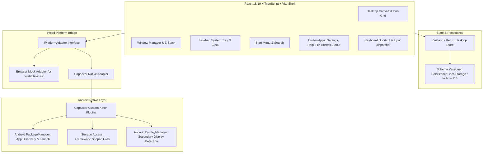

# Nothing Desk — Implementation Specification & Technical Blueprint

**Target Platform:** Android (Capacitor + Kotlin) & Web (React + TypeScript + Vite)  
**Document Version:** 1.0.0 • Implementation Architecture  
**Document Status:** Approved MVP Implementation Contract  
**Tracking File:** [`TRACKING.md`](file:///c:/Users/sanke/Desktop/NothigDesk/TRACKING.md)

---

## 1. Executive Summary & Vision

**Nothing Desk** is a React-first desktop environment designed specifically for Android phones. It delivers a desktop-style workspace with a desktop canvas, floating window manager, taskbar, start menu, system tray, keyboard/mouse-first interactions, and built-in utilities that operate seamlessly on a handheld smartphone screen, with Bluetooth peripherals, or when connected to an external display.

### 1.1 The Core Promise
> *"Open Nothing Desk and get a consistent desktop-style workspace, whether or not a monitor is connected."*

This promise governs the app's internal desktop shell and its built-in tool suite. It does not promise to force arbitrary third-party Android apps into floating desktop windows when the host Android OS or device vendor does not support it.

### 1.2 Non-Goals
1. **No OS Hijack:** Do not replace Android OS, the device lock screen, system settings, or global system gestures.
2. **No x86/.exe Emulation:** Android apps remain Android apps.
3. **No Unsanctioned Window Forcing:** Do not attempt unstable hacks to force external apps into floating windows if unsupported.
4. **No Root or Accessibility Abuse:** Zero requirement for root, bootloader unlocks, custom ROMs, or accessibility services.
5. **No Bloat:** Do not bundle heavy browser engines or full office suites in MVP; deliver fast, hyper-optimized built-in tools.

---

## 2. System Architecture

Nothing Desk employs a layered architecture separating pure web shell presentation from platform capabilities via a strict typed adapter pattern.



### 2.1 Technology Stack

| Layer | Technology | Responsibility |
| :--- | :--- | :--- |
| **Shell & UI** | React 18+ / 19, TypeScript, Vite | Canvas, icons, taskbar, start menu, window frames, dialogs |
| **Styling** | Vanilla CSS + CSS Variables | Nothing OS aesthetic (monochrome, dot matrix, red accents, glassmorphic blur, responsive scaling) |
| **State Management** | Zustand or lightweight Context/Reducer | Window lifecycle, z-order, focus state, active menus, notifications |
| **Input System** | Pointer Events API + Keyboard Registry | Unified touch/mouse/pen handling, Windows-standard shortcut interception |
| **Persistence** | `localStorage` + `IndexedDB` | Layout bounds, pinned apps, wallpaper preferences, theme configuration with auto-repair |
| **Platform Bridge** | TypeScript Interface + Capacitor Plugin | Typed contract between web UI and Android runtime |
| **Android Host** | Kotlin + Android SDK (API 29+) | App launcher intents, package query rules, SAF file streams, external display events |
| **Testing** | Vitest + Testing Library + Playwright | Unit tests, window state invariant verification, keyboard shortcut tests, E2E interaction |

---

## 3. Directory & File Organization

The project codebase follows a modular, feature-oriented structure:

```
NothigDesk/
├── android/                         # Capacitor Android project & native Kotlin bridge
│   └── app/src/main/java/           # Custom plugins (AppLauncher, DisplayDetect, FileBridge)
├── docs/                            # Hardware compatibility matrix, release notes
│   ├── capability_matrix.md
│   └── release_notes.md
├── src/
│   ├── app/                         # App entry, providers, global error boundary
│   │   ├── App.tsx
│   │   ├── ErrorBoundary.tsx
│   │   └── ShellRoot.tsx
│   ├── apps/                        # Built-in desktop applications
│   │   ├── about/                   # Version, diagnostics, build info, privacy
│   │   ├── file-access/             # Scoped Storage Access Framework file viewer
│   │   ├── help/                    # Searchable shortcut guide, platform capability info
│   │   └── settings/                # Themes, wallpapers, icon scale, taskbar behavior
│   ├── desktop/                     # Desktop shell components
│   │   ├── canvas/                  # Wallpaper layer, icon grid, selection box
│   │   ├── context-menu/            # Right-click / long-press desktop & icon menus
│   │   ├── icons/                   # Shortcut icon, badges, selection states
│   │   ├── start-menu/              # App launcher, search bar, pinned/all apps list
│   │   └── taskbar/                 # Taskbar items, system tray, clock, quick toggles
│   ├── persistence/                 # Storage schemas, migrations, fallback handlers
│   │   ├── migrations.ts
│   │   ├── schema.ts
│   │   └── storage.ts
│   ├── platform/                    # Typed platform abstraction layer
│   │   ├── capabilities.ts          # DesktopCapabilities definition & detection
│   │   ├── interface.ts             # IPlatformAdapter interface
│   │   ├── mockAdapter.ts           # Development & browser test adapter
│   │   └── nativeAdapter.ts         # Capacitor + Kotlin bridge adapter
│   ├── shortcuts/                   # Keyboard shortcut system
│   │   ├── dispatcher.ts            # Keydown listener, modifier parsing, conflict resolver
│   │   ├── map.ts                   # Windows-inspired shortcut definitions
│   │   └── types.ts
│   ├── styles/                      # Design system tokens and styles
│   │   ├── fonts.css                # Typography & font declarations
│   │   ├── global.css               # Reset, base styles, safe-area utilities
│   │   ├── nothing-theme.css        # Nothing OS monochrome tokens & dot-matrix textures
│   │   └── window.css               # Window frames, controls, resize grips
│   ├── windowing/                   # Window management engine
│   │   ├── controls/                # Minimize, maximize, close, window menu
│   │   ├── manager.ts               # State reducer / store actions (focus, z-index, bounds)
│   │   ├── pointer.ts               # Move, resize, snap zone event handlers
│   │   ├── types.ts                 # WindowState, Bounds, WindowAction
│   │   └── WindowFrame.tsx          # Reusable draggable/resizable window container
│   ├── index.html                   # HTML entry point with viewport & safe-area meta
│   └── main.tsx                     # React bootstrap
├── implementation.md                # Master implementation contract (this file)
├── TRACKING.md                      # Feature and change audit log
├── package.json
├── tsconfig.json
└── vite.config.ts
```

---

## 4. Technical Specifications & Subsystems

### 4.1 Window Management Engine

The window manager treats all built-in windows as first-class desktop entities with strict invariants:

#### Window Invariants
1. **Unique Identity:** Every active window has a stable `id` and recognized `appId`.
2. **Deterministic Focus & Z-Index:** Exactly one window is active/focused at any time. Clicking or focusing a window increments the global z-index stack without index thrashing.
3. **Bounded Dimensions:** Windows have strict minimum dimensions (`minWidth: 320px`, `minHeight: 220px`).
4. **Restore Safety:** When maximized, the pre-maximized restore bounds (`prevBounds: { x, y, width, height }`) must be preserved and distinct from maximized bounds.
5. **Screen Resize / Orientation Clamping:** When viewport dimensions change (phone rotation, external display plug/unplug), all open windows are clamped so their title bars remain accessible within safe areas.
6. **Taskbar Coherence:** Minimizing hides window content while retaining its in-memory DOM/state; the taskbar displays active, focused, or minimized states.

#### Window Data Model
```typescript
export interface WindowBounds {
  x: number;
  y: number;
  width: number;
  height: number;
}

export type WindowStateMode = 'normal' | 'minimized' | 'maximized';

export interface WindowInstance {
  id: string;
  appId: 'settings' | 'help' | 'files' | 'about' | string;
  title: string;
  icon: string;
  state: WindowStateMode;
  bounds: WindowBounds;
  prevBounds: WindowBounds;
  zIndex: number;
  isFocused: boolean;
  minWidth: number;
  minHeight: number;
  allowResize: boolean;
  allowMaximize: boolean;
}
```

---

### 4.2 Platform Capability & Bridge Contract

Components **never** make direct raw calls to Capacitor plugins or browser globals. All native communication passes through `IPlatformAdapter`, returning explicit typed result objects.

```typescript
export interface DesktopCapabilities {
  canListLaunchableApps: boolean;
  canLaunchAndroidApps: boolean;
  hasExternalDisplay: boolean;
  supportsSeparateExternalDesktop: boolean;
  supportsSystemWindowing: boolean;
  hasHardwareKeyboard: boolean;
  hasPointerDevice: boolean;
}

export type NativeResult<T> =
  | { ok: true; value: T }
  | { ok: false; code: string; message: string };

export interface InstalledApp {
  packageName: string;
  label: string;
  iconUrl?: string;
  isSystemApp: boolean;
}

export interface IPlatformAdapter {
  getCapabilities(): Promise<DesktopCapabilities>;
  getInstalledApps(): Promise<NativeResult<InstalledApp[]>>;
  launchApp(packageName: string): Promise<NativeResult<boolean>>;
  pickUserFile(options?: { mimeType?: string }): Promise<NativeResult<FileReference>>;
  pickUserDirectory(): Promise<NativeResult<DirectoryReference>>;
  requestLockScreen(): Promise<NativeResult<boolean>>;
  onDisplayChange(callback: (capabilities: DesktopCapabilities) => void): () => void;
  // System Subsystems & Control Center Bridge
  openWifiPanel(): Promise<NativeResult<boolean>>;
  openBluetoothSettings(): Promise<NativeResult<boolean>>;
  openVolumePanel(): Promise<NativeResult<boolean>>;
  openDisplaySettings(): Promise<NativeResult<boolean>>;
  getWifiInfo(): Promise<NativeResult<{ isEnabled: boolean; ssid: string; signalStrength: number }>>;
  getBluetoothInfo(): Promise<NativeResult<{ isEnabled: boolean; bondedDevices: Array<{ name: string; address: string; isConnected?: boolean }> }>>;
  toggleFlashlight(enable?: boolean): Promise<NativeResult<boolean>>;
  // Telephony & Phone Dialer Bridge
  getDeviceContacts(): Promise<NativeResult<DeviceContact[]>>;
  getDeviceCallLog(): Promise<NativeResult<DeviceCallLogItem[]>>;
  makePhoneCall(number: string): Promise<NativeResult<boolean>>;
}
```

---

### 4.3 Windows-Inspired Shortcut Registry

All keyboard shortcuts are managed through a centralized registry that prevents key conflict drift and supports in-app documentation.

| Shortcut | Action | Conflict & Fallback Handling |
| :--- | :--- | :--- |
| `Meta` / `Windows` | Toggle Start Menu | May be reserved by Android; provide `Ctrl + Space` fallback |
| `Ctrl + Space` | Open Start & Focus Search | Primary universal fallback for Start menu |
| `Meta + D` | Show Desktop / Minimize All | Preserves previous window state map for quick restoration |
| `Alt + Tab` | Cycle Built-in Windows | Managed in-shell; passes cleanly to Android if intercepted |
| `Alt + F4` | Close Active Window | Gracefully closes top window; never force-closes Android shell |
| `Ctrl + W` | Close Active Tab / Window | App-specific window close |
| `Ctrl + Shift + Esc` | Open Running Windows Panel | Nothing Desk Task Manager; cleanly labeled |
| `Meta + E` | Open File Access | Launches built-in scoped file viewer |
| `Meta + I` | Open Nothing Desk Settings | Opens desktop settings (distinct from Android Settings) |
| `Esc` | Dismiss Overlays / Menus | Closes Start, context menus, search dialogs; cancels drags |
| `Enter` / `Space` | Activate Selection | Respects focused input fields without triggering shell action |
| `Tab` / `Shift + Tab` | Move Focus Forward / Backward | Standard visible focus traversal |
| `Arrow Keys` | Navigate Menus & Grid | Context-sensitive grid traversal |
| `F2` | Rename Desktop Shortcut | Renames local shortcut metadata; does not modify Android app |
| `Delete` | Remove Desktop Shortcut | Unpins from desktop; prompts confirmation |
| `Shift + F10` | Context Menu | Keyboard alternative to right-click / long-press |

---

### 4.4 Design System: The Nothing Aesthetic

The user interface follows Nothing OS's distinctive visual identity:
1. **Palette:** Pure monochromatic black (`#000000`), deep dark grays (`#111111`, `#1c1c1e`), translucent frosted glass (`rgba(20, 20, 22, 0.75)`), crisp white text (`#f4f4f4`), muted secondary text (`#888888`), and the iconic signature Nothing red accent (`#d71921` / `#eb0029`).
2. **Textures:** Subtle dot matrix patterns (`radial-gradient`), precision 1px borders (`rgba(255, 255, 255, 0.12)`), and smooth backdrop filters (`backdrop-filter: blur(24px)`).
3. **Typography:** Geometric modern sans-serif paired with dot-matrix styling for clock, titles, and system indicators.
4. **Touch & Pointer Adaptivity:** Minimum 44x44px touch targets on mobile touch mode, scaling down to high-density desktop cursor targets when pointer/mouse is detected.

---

## 5. Phased Build Plan & Milestones

### Phase 0: Project Architecture & Environment Setup
- Initialize Vite + React + TypeScript project with strict typechecking.
- Establish clean directory structure per specification.
- Create Vanilla CSS design system tokens (Nothing OS aesthetic).
- Set up typed Platform Adapter interface with comprehensive mock for browser development.
- Establish [`TRACKING.md`](file:///c:/Users/sanke/Desktop/NothigDesk/TRACKING.md) with full traceability.

### Phase 1: Core Desktop Shell & Input Foundation
- Implement responsive Desktop Canvas supporting safe-area insets.
- Create Wallpaper engine (bundled Nothing minimal wallpaper + custom image picker).
- Build Icon Grid with single-tap (touch) and double-click (pointer) activation.
- Construct Desktop Context Menu (Open, Pin to Taskbar, Rename, Remove, Details).
- Implement Taskbar with pinned items, active window indicators, Start button, and system clock/tray.
- Implement Start Menu with instant search, pinned apps, all apps, and keyboard navigation.

### Phase 2: Window Management Engine
- Develop Window Frame component with draggable title bar, resize handles (8 directions), and controls.
- Implement Window Manager store with z-index stacking, active window focus, minimize, maximize, and restore.
- Implement responsive clamping to keep title bars accessible across rotation and viewport changes.
- Add window context menu (Minimize, Maximize, Close, Restore).

### Phase 3: Built-in Core Applications
- **Settings App:** Wallpaper selection, icon grid scale, theme accents, taskbar settings, full reset.
- **Help & Shortcut Center:** Searchable Windows-compatible shortcut reference, hardware peripheral guide.
- **About App:** Version info, capability diagnostics, system architecture disclosure, issue report copy tool.
- **File Access App:** Scoped file viewer using typed adapter, safe preview, transparent permission handling.

### Phase 4: Persistence, Shortcuts & State Invariants
- Implement schema-versioned persistence (`localStorage` / `IndexedDB`).
- Add corrupt state recovery and layout normalization routines.
- Implement global Keyboard Shortcut Registry & Dispatcher (`Meta`, `Ctrl+Space`, `Alt+Tab`, etc.).
- Ensure shortcuts do not steal focus during text input typing.

### Phase 5: Native Android Bridge & Packaging
- Initialize Capacitor project structure for Android.
- Implement custom Kotlin plugins:
  - `AppLauncherPlugin`: Query launchable intent activities, launch apps.
  - `DisplayDetectPlugin`: Query secondary displays and display modes.
  - `StorageBridgePlugin`: Storage Access Framework picker.
- Wire native bridge into `NativeAdapter` with seamless fallback to `MockAdapter`.

### Phase 6: External Display Support & Peripheral Hardening
- Implement display mode state machine (`PHONE_TOUCH`, `PHONE_POINTER`, `EXTERNAL_MIRROR`, `EXTERNAL_DESKTOP`).
- Verify secondary display presentation surface behavior.
- Test Bluetooth keyboard and mouse reconnection and focus preservation.
- Document device compatibility matrix and verified hardware.

### Phase 7: Polish, Accessibility, Performance & QA
- Execute comprehensive test matrix (rotation, low-memory restart, corrupt JSON, rapid window cycling).
- Audit accessibility: visible focus rings, ARIA roles, logical tab order, keyboard navigability.
- Profile 60fps drag/resize and verify cold launch time under 2.5 seconds.
- Final documentation and release candidate verification.

---

## 6. Change Tracking & Governance Rule

> **MANDATORY POLICY:**  
> Every change, feature addition, architectural adjustment, or fix implemented in this repository **must** be recorded immediately in [`TRACKING.md`](file:///c:/Users/sanke/Desktop/NothigDesk/TRACKING.md).  
> Entries must contain:
> - Date & Timestamp
> - Phase & Feature Identifier
> - Component / File Path
> - Status Update (`Planned`, `In Progress`, `Completed`, `Verified`)
> - Summary of Changes and Implementation Details

---
*Reference: Nothing Desk MVP Product & Technical Specification (Version 1.0 • 17 Oct 2026).*
